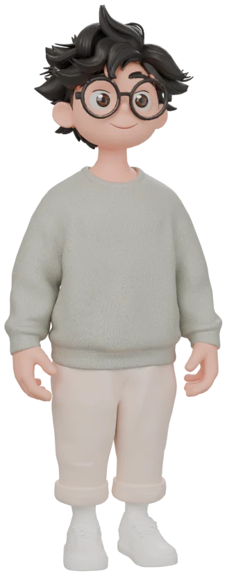

<p align="center">
  
</p>

<h1 align="center">Rith Seyhak</h1>

<p align="center"><em>My 3D twin naps more than I do.</em></p>

<br>

I'm a Computer Science student at the Cambodia Academy of Digital Technology, based in Phnom Penh, Cambodia. I like the space where development and design meet: full-stack web development, mobile apps, UI/UX design, and the problem solving that holds them together.

This repository is my portfolio, the second version of it.

## About this portfolio

It's a personal space more than a résumé. It covers who I am, the tools I work with, the projects I've built, my path through school and work so far, and how to get in touch.

I treated it as a design project as much as a development one. I wanted a site that feels made by a person, not filled into a template.

## Design

The look is minimal and editorial, closer to a well-set printed page than a typical developer site. Warm cream and off-white backgrounds, Fraunces serif headings over Inter body text, one restrained blue accent, and plenty of whitespace. Motion stays quiet: sections reveal and settle, then get out of the way. I aimed for something thoughtful and welcoming, with enough personality to be remembered.

## Things to try

- **Say hi to the avatar.** A 3D version of me stands in the hero. It follows your cursor, turns when you drag it, and reacts to clicks with a thumbs-up, a shrug or a wave. Leave it alone and it looks around, checks its watch, and eventually dozes off. A smaller one waits beside the Work heading.
- **Explore the Skills Constellation.** The technologies I work with, laid out in 3D and connected to the tools they're used alongside. Filter by category, or select a node to see related technologies and the projects that use it.
- **Scroll through the work.** Projects take the stage one at a time on a pinned, scroll-driven scene. Open one for a full-screen view with its gallery, or hover a tech pill to light it up in the constellation.
- **Press Ctrl / ⌘ + K.** A command palette for jumping between sections, switching between Paper, Sepia and Dark themes, or opening my links.

The layout adapts down to phone size, respects reduced-motion settings, and the 3D scenes fall back gracefully on devices that can't run them.

## Built with

- **Framework:** Next.js 14 (App Router, static export) and React 18
- **Styling:** Tailwind CSS and hand-written CSS
- **3D and animation:** Three.js, React Three Fiber and Drei, with custom scroll and CSS motion. The avatar model was made with Meshy (CC BY 4.0).
- **Libraries:** EmailJS for the contact form, React Icons
- **Development tools:** TypeScript, ESLint, PostCSS

The Skills section on the site is a different list: it maps what I use in my own work, from React, Angular and Flutter to NestJS, PostgreSQL and Unity.

## Featured projects

A selection of what I've built, including three platforms from my internship with the CamCyber Digital Tech Team.

- **MLMUPC Human Resource Management System** (2026): a ministry-wide HR platform for the Ministry of Land Management, Urban Planning and Construction, taking civil-servant administration digital for nearly 3,000 officers.
- **NIS Human Resource Management System** (2026): a government HR platform for the National Institute of Statistics, with on-site face-scanner check-ins connected to the cloud for 500+ officers.
- **PhumiYerng** (2026): a community tourism and marketplace app for rural Cambodia, bringing 19 communities of the World Bank-backed LASED III programme onto one platform.
- **[Modula POS](https://github.com/Zorng/ModulaFrontend)** (2025): a pay-as-you-go point-of-sale platform with a modern UI and a streamlined checkout flow.
- **[Melodia](https://github.com/R-Seyhak/Melodia-Spotify-clone-)** (2024): a Spotify-style music dashboard built on the MERN stack, with playback and playlists.
- **[FrostGuard](https://github.com/Ra-Fat/Frost-Guard)** (2024): a 3D tower defense game in Unity, with wave-based enemies and upgradable towers.

The site gives each one a closer look, with screenshots, my role and the features I worked on.

## Run it locally

You'll need Node.js 18.17 or newer.

```bash
git clone https://github.com/R-Seyhak/Portfolio-V2.git
cd Portfolio-V2
npm install
npm run dev
```

Then open [localhost:3000](http://localhost:3000). `npm run build` produces a static site in `out/`.

The contact form sends mail through EmailJS. To try it locally, add your own keys to a `.env.local` file. Everything else works without them.

```dotenv
NEXT_PUBLIC_EMAILJS_SERVICE_ID=...
NEXT_PUBLIC_EMAILJS_TEMPLATE_ID=...
NEXT_PUBLIC_EMAILJS_PUBLIC_KEY=...
```

## Say hello

Internships, collaborations, side projects, or just a friendly hello: all welcome. I'm on UTC+7 and usually reply within a day.

- Email: [seyhakrithwk@gmail.com](mailto:seyhakrithwk@gmail.com)
- GitHub: [github.com/R-Seyhak](https://github.com/R-Seyhak)
- LinkedIn: [linkedin.com/in/seyhak-rith-wk](https://www.linkedin.com/in/seyhak-rith-wk)
